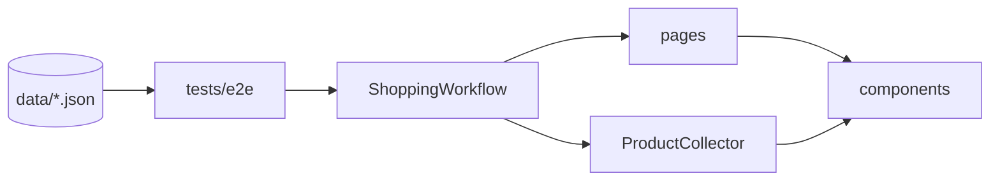

# Shop automation: search, cart, budget check

[](https://github.com/Alexli18/shop-e2e-playwright/actions/workflows/tests.yml)
[](https://alexli18.github.io/shop-e2e-playwright/)

Python + Playwright (pytest-playwright) automation built with OOP and the Page Object Model.

**The scenario:**
1. Authenticate.
2. Search products by name under a maximum price (with paging).
3. Add them to the cart, choosing random variants.
4. Assert that the cart Sub-Total does not exceed `max_price × number of items`.

Inputs come from JSON, and every run produces HTML, JUnit XML and Allure reports.

**Why the Tricentis demo shop:** the brief names eBay as an example, but eBay answers automated searches with
HTTP 403 from its Akamai bot protection ([evidence](docs/evidence/ebay-403.txt), [screenshot](docs/evidence/ebay-403.png)).
The same scenario therefore runs against the [Tricentis Demo Web Shop](https://demowebshop.tricentis.com), a
shop published for test automation.

## Reviewing this repo

- **The four functions:** [src/shop/workflow.py](src/shop/workflow.py).
- **Page objects:** [src/shop/pages/](src/shop/pages/) and [src/shop/components/](src/shop/components/).
- **The e2e test and its data:** [tests/e2e/test_shopping_flow.py](tests/e2e/test_shopping_flow.py) with
  [data/shopping_cases.json](data/shopping_cases.json).
- **A sample run:** [reports/](reports/) (HTML, JUnit XML, screenshots), and the latest CI run as an
  [Allure report](https://alexli18.github.io/shop-e2e-playwright/).
- **The bug review:** [ReadMeAIBugs.md](ReadMeAIBugs.md).
- **Offline tests of the same code** (no network): [tests/unit/](tests/unit/) and
  [tests/component/](tests/component/), which run the page objects and the workflow against a fake shop
  served by `page.route` (paging, price filter, variants, cart, budget).

## Quick start

Python >= 3.11 and internet access (the e2e tests run against the live demo shop).

```bash
python3 -m venv .venv && source .venv/bin/activate
pip install -e '.[test]'
playwright install chromium

pytest -m e2e                              # the assignment scenario, all 6 data cases (~1.5 min)
pytest -m e2e -k sneakers --headed         # one case, in a visible browser
pytest -m "unit or component" -n auto      # offline tests (~30 s)
```

More commands, the data-file fields, profiles and environment variables: [docs/running-tests.md](docs/running-tests.md).

## The four assignment functions

All four are in `ShoppingWorkflow` ([src/shop/workflow.py](src/shop/workflow.py)); `run(case)` chains them
as in the brief's example.

| Function | What it does | Page objects |
|---|---|---|
| `authenticate()` | Registers `qa_<uuid8>@example.com`, logs out and back in (or logs in with `SHOP_EMAIL`) | `RegisterPage`, `LoginPage`, `Header` |
| `search_items_by_name_under_price(query, max_price, limit=5)` | Uses the on-page price filter, extracts cards with XPath, re-checks each price, follows **Next** until `limit` or the last page; 0 results is valid | `SearchPage`, `ProductGrid`, `ProductCard`, `Pager` |
| `add_items_to_cart(urls)` | Each product opens in a new tab: random variants (seeded), required text fields, Add to cart, notification checked, tab closed. One screenshot and one log entry per item | `ProductPage`, `ProductOptions`, `Notification` |
| `assert_cart_total_not_exceeds(budget_per_item, items_count)` | Reads the cart Sub-Total as shown and asserts `<= budget_per_item × items_count`; screenshot | `CartPage`, `CartTotals` |

## Architecture

```
src/shop/  pages/ components/   page objects (locators live only here)
           workflow.py          the four functions
           collector.py         price filter, limit, paging guards
           models.py prices.py config.py artifacts.py markup.py
tests/     e2e/ (live)   unit/ component/ (no network)   plugins/ support/ fixtures/
data/      shopping_cases.json        config/  environments.json (profiles)
```



Details and design rules: [docs/architecture.md](docs/architecture.md).

## Assumptions and limitations

- **Site and currency:** the demo shop replaces eBay; prices are in USD as displayed and are parsed to `Decimal`; other number formats (`1.234,56`) are rejected, not guessed.
- **Authentication:** a real account, not a stub or guest: a new user is registered per test (or `SHOP_EMAIL` / `SHOP_PASSWORD` are used).
- **Search paging:** the search shows 8 results per page and filters by price on the server, so it reaches page 2 only when `limit` > 8 (one case does).
- **Quantity:** one unit per item by default, because the budget is per item. A case can opt in to random quantities (`max_quantity`); the budget then counts units.
- **Variants:** a random choice in every dropdown and radio group; optional checkboxes keep their defaults (logged with their surcharges). Required text fields get generated test data.
- **Items that cannot be bought** are logged and skipped only on the shop's own signs: "Out of stock", an empty purchase block (not sold online), "Add to wishlist" only, or a required file upload. Any other product page must show Add to cart, or the test fails ("has the markup changed?"), so a broken locator cannot leave the cart empty and pass. The budget still counts every found URL, as in the brief's example, so skipped items only loosen it.
- **The checked value is the cart Sub-Total**, which includes option surcharges, not the listed price. It must equal the sum of the cart lines, and each added product's line must list the variants that were chosen.
- **The budget check rarely fails on this shop:** the search filters by price on the server, so every found item is already <= `max_price`; only option surcharges (or random quantities) can push the total over. Its failing path, and the use of the price filter, paging and card prices, are covered by the offline component tests.
- **Shared demo data:** stock and catalogue can change between runs.
- **Browsers:** Chromium and Firefox are verified; WebKit is not.

## Reports

| Report | Where |
|---|---|
| A normal run | `artifacts/` (git-ignored): HTML and JUnit reports, Allure results, per-test screenshots, `run-log.json`, traces on failure |
| Committed sample of a full run | [reports/report.html](reports/report.html), [reports/junit.xml](reports/junit.xml) |
| Screenshots of one assignment case | [reports/sample-run/](reports/sample-run/) |
| Allure report of the latest CI run | [alexli18.github.io/shop-e2e-playwright](https://alexli18.github.io/shop-e2e-playwright/) |

Locally: `allure serve artifacts/allure-results` (needs the Allure CLI). To refresh the committed sample, run
`python scripts/refresh_sample_report.py`.

## CI (GitHub Actions)

[.github/workflows/tests.yml](.github/workflows/tests.yml):

| Job | When | What |
|---|---|---|
| `lint` | every push and pull request | ruff, ruff format, mypy |
| `unit-component` | every push and pull request | offline tests on Python 3.11 and 3.12 |
| `smoke` | pull requests | the smoke case of the e2e scenario (Chromium) |
| `e2e` | push to `main`, nightly, manual | all data cases on Chromium and Firefox, one rerun for the public site's hiccups |
| `allure-report`, `deploy-pages` | after `e2e` | merges both browsers into one Allure report and publishes it to GitHub Pages |

Dependencies are installed from hash-locked files (`requirements.lock`); third-party actions are pinned to
commit SHAs.
