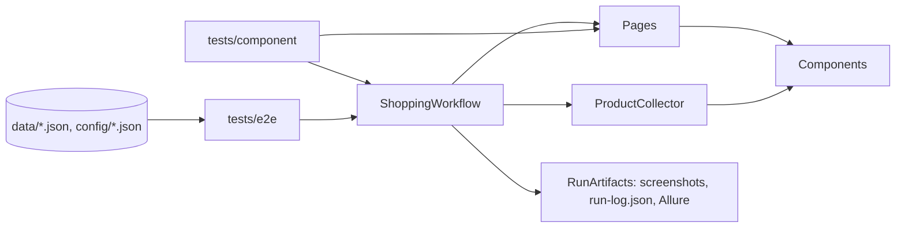

# Architecture

```
src/shop/
  pages/        BasePage (+ ListingPage), RegisterPage, LoginPage, SearchPage, CategoryPage, ProductPage, CartPage
  components/   Header, Notification, AdvancedSearchForm, ProductGrid, ProductCard, Pager, ProductOptions,
                CartTable, CartTotals
  collector.py  ProductCollector: price filter, limit, dedupe and paging guards over a listing's grid + pager
  base_workflow.py, workflow.py
                ShoppingWorkflow: the four assignment functions + run(case), on a small BaseWorkflow
  models.py     dataclasses + the loader and validation of the shopping cases (data/shopping_cases.json)
  artifacts.py  screenshots + JSON run log, attached to Allure
  config.py     environment profiles (config/environments.json), optional credentials from the environment
  prices.py     price parsing to Decimal ("1,215.00", "From 500.00"); other number formats are rejected
  markup.py     class names of the shop's markup shared by several page objects and components
```



## Design rules

- **Locators live only in pages and components.** Tests and the workflow contain no selectors.
- **Locators:**
  - Labels and roles where the site supports them (forms, buttons, links).
  - **XPath for product-card extraction**, as the brief requires, scoped to the main results column.
  - CSS only where the markup offers nothing better.
- **No sleeps.** Playwright auto-waiting plus `expect()`. Page objects only wait for the result of their own
  action (the notification after Add to cart, the next page number after Next).
- **Zero results must be explained.** A search page that shows neither product cards nor the shop's
  "No products were found" message fails with "has the markup changed?", so a broken locator cannot pass as
  an empty result.
- **Seeded randomness.**
  - Variant choice uses `random.Random(case.seed)`, so a failing run can be replayed.
  - Random quantities are drawn only when a case opts in (`max_quantity`).
  - Optional checkbox extras keep their defaults.
- **Money is `Decimal`**, parsed from the text the shop shows.
- **One tab per product.** Each product opens in a new tab of the same context, which is closed after adding,
  so the search tab stays on the results page.
- **Single responsibility:**
  - Pages and components know the DOM.
  - `ProductCollector` knows the collection rules.
  - The workflow knows the journey and asserts nothing. The one exception is the brief's own
    `assert_cart_total_not_exceeds`, which is an assertion by name; it also returns the `CartSnapshot`.
  - `RunArtifacts` knows reporting.
  - Tests own the assertions.
- **Offline component tests.** `tests/component` routes every request of the browser context to a fake shop
  built from HTML copied from the live site (`page.route`), so paging, price filtering, variants and the cart
  check are tested in seconds without the network.
